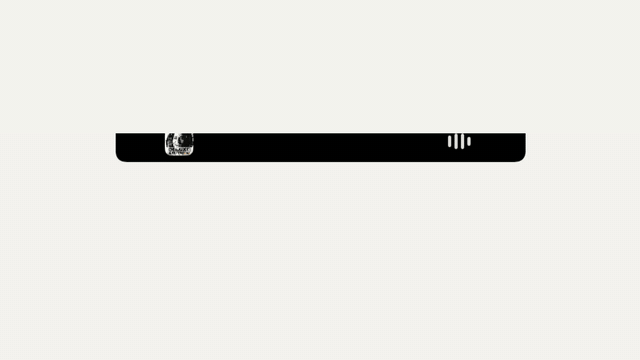
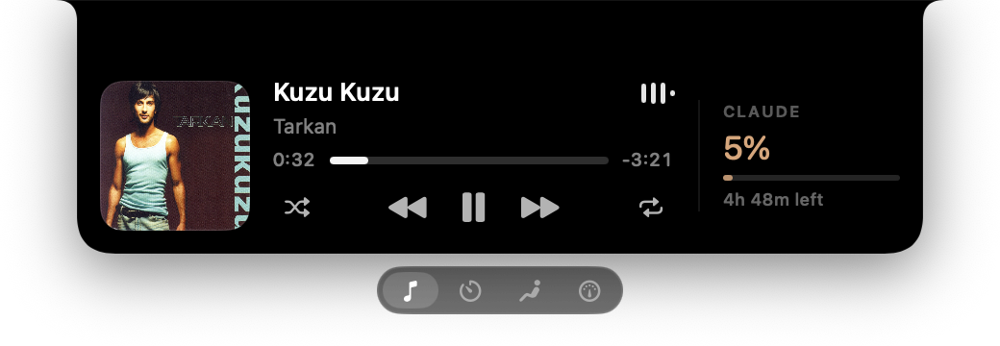
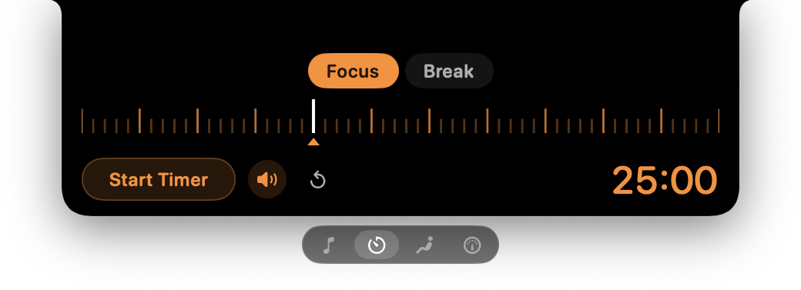
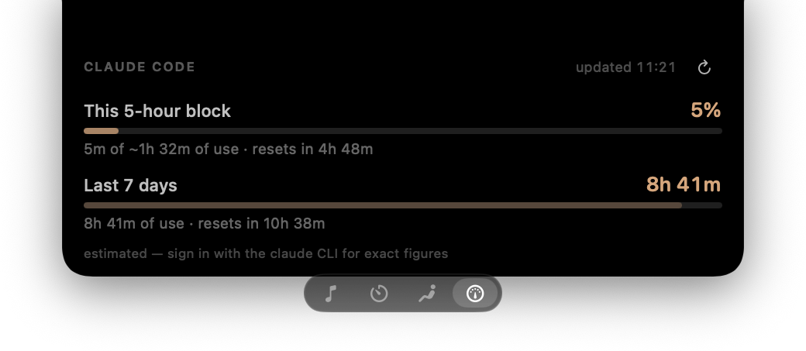

# Islet

Hover your MacBook's camera notch and it grows into a panel. Move away and it
disappears completely.







**Music** — now playing from Spotify or Apple Music: large artwork, a scrubbable
progress bar and transport controls. Click the artwork to jump to the app it is
playing in.

**Claude** — how much of the current Claude Code five-hour block you have spent,
beside the transport. Click it for the weekly window too. The column and its tab
disappear entirely if you don't use Claude Code.

**Shelf** — every screenshot you take lands here the moment it is written, and
the panel opens for a few seconds to show it. Click one to open it the way the
system thumbnail does, or drag it straight out into Finder, a chat or a mail
draft. macOS draws its own thumbnail in the corner, but you cannot pull a file
out of it once it has faded; this one keeps the last four until you use them.

**Posture** — with AirPods in, how far your head is tipped forward of where you
calibrated upright, and how much of today has been spent that way. If it stays
down for a few minutes, the notch says so once and then leaves you alone.

**Timer** — a pomodoro with Focus and Break modes. Plus battery alerts when the
charger goes in or out, and an option to stay visible on the lock screen.

While something is playing, a small summary sits beside the notch:


## Install

Needs macOS 14+ and the Xcode Command Line Tools.

```bash
git clone https://github.com/KaanCan1/Islet.git
cd Islet
make install
```

That's it — the app is built, copied to `/Applications` and launched. It lives in
the menu bar with no Dock icon, and every setting is in that menu. **Right-click
the open panel for the same menu** — a notch halves the menu bar, and macOS
quietly hides the status items that no longer fit, so the icon is not always
there to click. Use `make run` to try it without installing.

## Permissions

macOS asks for these the first time each is needed. Everything Islet reads stays
on the machine; the only network request it ever makes is to Anthropic, for your
own usage figures.

| Prompt | What for | Needed? |
|---|---|---|
| **Automation** — "Islet wants to control Spotify" | Reading the current track and driving the transport | Yes, for the music panel |
| **Keychain** — "Islet wants to access Claude Code-credentials" | The OAuth token, to ask Claude for your real usage percentages. Islet also renews that token when it ages out, which means writing the item back | Only for exact Claude figures; declining falls back to a local estimate |
| **Accessibility** | Emulating the media keys when something other than Spotify or Music is playing | No, only if you use the transport buttons in that case |
| **Files and Folders** — "Islet wants to access files in your Desktop folder" | Watching wherever screenshots are saved, so the shelf can catch them | Yes, for the shelf; it reads nothing else in that folder |
| **Motion** — "Islet wants to access motion activity" | Head angle from AirPods, for the posture tab | Only for posture, which is off until you switch it on |

The keychain prompt asks for your **login password**, not just Allow/Always Allow,
and it comes back after every Islet update. That is macOS, not a bug: it pins the
grant to the exact binary (its cdhash), which each build changes, and "Always
Allow" only appends to the item's trusted-app list without touching that pin. One
password entry per installed version is the floor for a self-signed app; only an
Apple Developer ID certificate, which pins to a stable team id instead, would
carry a grant across updates. `Islet --keychain-trust` says which side of it the
running build is on, and reads nothing but the access list, so it never sets off
the prompt it explains.

Islet also asks once, itself, before reading anything under `~/.claude` — macOS
does not gate that directory, so nothing would otherwise stop an app reading it
quietly. Answer "Not now" and none of it is touched.

## Notes

- Now playing comes from AppleScript, not private APIs: macOS 15.4 closed
  `MediaRemote` to unentitled apps.
- The shelf watches whichever folder `com.apple.screencapture` points at, usually
  the Desktop. A new file only counts as a screenshot if `screencapture` stamped
  it with the `kMDItemIsScreenCapture` extended attribute, which it writes as the
  file is saved — so everything else you keep on the Desktop is ignored, and no
  Spotlight query is involved. Nothing is copied: the shelf holds references, and
  taking an item off it leaves the file exactly where it was.
- **Posture is head angle, not posture.** It measures how far your head is tipped
  forward of the angle you called upright, which is a decent stand-in for leaning
  into the screen and says nothing at all about your back. Sitting badly with a
  level head reads as fine. It is a nudge, not advice, and certainly not medical
  advice. Everything is measured against a reference angle, because the sensor's
  own zero is useless: a head that is level reads about -15 degrees, so measuring
  from zero calls you slouched before you have moved. Islet settles on that
  reference from your first few seconds of wearing them, which means whatever you
  were doing then counts as upright — press "Set upright" to fix it properly.
- Posture needs AirPods Pro, AirPods (3rd generation) or AirPods Max, and it only
  streams head motion while the feature is switched on — it costs AirPods battery,
  which is why it is off by default. The angle has to hold past the threshold for
  ninety seconds within any three-minute stretch before anything is said, and
  there is ten minutes of quiet afterwards. Counting across a window rather than
  demanding one unbroken run is the point: at a desk the angle crosses the line
  constantly and rarely stays over it, so a rule that resets every time you lift
  your head tracks perfectly and never speaks. Glancing at the keyboard still
  never sets it off — those add up to nowhere near ninety seconds.
- **Claude figures are the real ones** when the token is reachable: Islet reads
  `GET /api/oauth/usage` on api.anthropic.com, the same endpoint `/usage` reads,
  and the panel says so. The token is the one the `claude` CLI writes to the login
  keychain — a desktop-app-only install doesn't have it, so log in once with the
  CLI and Islet switches over on its own. Access tokens last under a day, so Islet
  renews them with the stored refresh token and writes the new pair back where the
  CLI keeps it. Writing back is the point: the endpoint rotates the refresh token,
  and keeping the new one to itself would log you out of Claude Code. Only that one
  item is touched, in place, and everything else stored alongside it is preserved.
- Without it, usage is **estimated** from `~/.claude/projects/*.jsonl` — timestamps
  and token counts only, never message content. Expect roughly a quarter of
  spread: nothing on disk states the account's limits, so the ceiling is inferred
  from the moments Claude actually cut you off, and those disagree with each other
  by up to 3.5x. The panel labels which of the two you are looking at.
- Scanning is incremental, so only the first pass is slow — about 12 seconds for
  380 MB of transcripts, on a background thread. It refreshes every minute, and
  the panel has a refresh button.
- The Claude column and its tab disappear entirely if you don't use Claude Code.
- Displays without a notch get a virtual one at the top centre of the screen.
- In full-screen apps macOS slides the menu bar down the moment the cursor touches
  the top edge. That's the system, not Islet. To stop it: System Settings → Control
  Center → Menu Bar → "Automatically hide and show the menu bar" → Never.
- `./dist/Islet.app/Contents/MacOS/Islet --diagnose` prints every screen, the
  detected notch size, permission state, and where the Claude figures came from.
- `Islet --posture` watches the head angle for twelve seconds and prints what it
  gets, which is the only way to tell a refused permission from absent AirPods
  from a reference angle that has gone wrong. Launch it through `open` rather
  than running the binary from a shell: macOS attributes a shell-launched binary
  to the shell, and CoreMotion has the process killed on the spot. `open
  ./dist/Islet.app --env ISLET_PROBE_OUT=/tmp/posture.txt --args --posture`
  writes the report to a file, since a launched app has no terminal to print to.
  Quit Islet before running it: only one process at a time is fed head motion,
  and the one that loses is fed silence rather than an error, so a probe started
  next to the running app reports nothing and blames the AirPods for it.
- `open ./dist/Islet.app --env ISLET_STATE_LOG=/tmp/islet.log` writes what the
  posture monitor is doing inside the running app every two seconds — the live
  angle, whether it has a reference yet, and which tabs the panel is showing.
  It is the only way to see that, for the reason above.

## License and notices

The code is MIT licensed — see [LICENSE](LICENSE). Do what you like with it.

Islet is an independent personal project. It is **not affiliated with, endorsed
by, or sponsored by Anthropic, Spotify, or Apple**. Those names, and Claude,
Claude Code, Spotify and Apple Music, are trademarks of their respective owners
and appear here only to say what the app talks to.

Islet displays nothing of its own beyond its interface. Album artwork, track and
artist names come from whichever player you are running and belong to their
rights holders; the app shows them the way any music player shows them, and keeps
no copy beyond a temporary file for the current track. The artwork visible in the
screenshots and the demo recording is incidental for the same reason.

Usage figures are read from your own Claude account, with your own credentials, on
your own machine. Islet sends nothing anywhere else and stores no telemetry.
